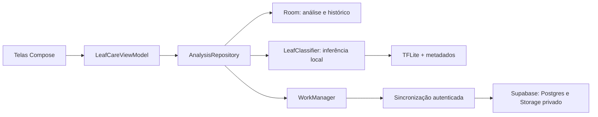
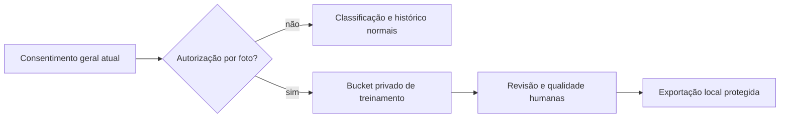

# Mapa do repositório LeafCare

Este mapa aponta para as áreas mantidas atualmente. Para instruções de uso e validação, comece pelo [README](../../README.md); este arquivo resume a estrutura e as relações entre os módulos.

## Pastas principais

```text
.
├── android-app/
│   └── app/src/
│       ├── main/java/br/com/leafcare/
│       │   ├── auth/      # login, cadastro, recuperação e aceite legal
│       │   ├── data/      # Room, análises, consentimentos e sincronização
│       │   ├── ml/        # decodificação, pré-processamento e inferência local
│       │   ├── admin/     # administração, galeria e revisão de fotos
│       │   └── ui/        # telas Compose
│       ├── main/assets/   # bundle TFLite, classes e catálogo
│       ├── test/          # testes JVM/Robolectric
│       └── androidTest/   # testes instrumentados
├── machine-learning/
│   ├── leafcare/          # contrato de dados, treino e inferência Python
│   ├── experiments/       # receitas e experimentos reproduzíveis
│   ├── artifacts/         # bundle e metadados versionados
│   ├── benchmark_artifacts/ # evidências históricas preservadas
│   └── tests/             # testes Python
├── supabase/
│   ├── migrations/        # histórico de schema e políticas
│   ├── functions/         # funções do backend
│   └── tests/             # cenários SQL e testes de função
├── docs/                  # guias operacionais, QA, proveniência e relatórios
├── openspec/              # specs atuais, mudanças e arquivo
└── .agents/skills/        # workflows OpenSpec do projeto
```

## Fluxos centrais





## Fonte de verdade por assunto

| Assunto | Referência principal |
| --- | --- |
| Comportamento e setup do app | [README](../../README.md) e [Desenvolvimento](../DEVELOPMENT.md) |
| Arquitetura Android e persistência | [Arquitetura](../ARCHITECTURE.md) |
| Contrato, treino e métricas do modelo | [Machine Learning](../MACHINE_LEARNING.md) e `machine-learning/README.md` |
| Auth, RLS, Storage e migrations | [Supabase](../SUPABASE.md) |
| Papéis e revisão administrativa | [Superadmin](../SUPERADMIN.md) |
| Roteiro e resultados de QA | [Testes](../TESTING.md) |
| Contratos de comportamento | [OpenSpec](../../openspec/README.md) e `openspec/specs/` |

## Código e artefatos históricos

O bundle TFLite, catálogo, classes, migrations, testes e licenças têm consumidores ou valor de proveniência; não os remova por não serem referenciados diretamente por uma tela.

`machine-learning/legacy/`, receitas de ensemble e pastas de experimentos são históricas e isoladas do treino/exportação padrão atual. Alguns arquivos permanecem cobertos por testes de proteção. Os arquivos em `benchmark_artifacts/` e `docs/model-reports/` registram resultados já publicados e devem ser tratados como evidência, não como lixo de build.

Os documentos em `docs/explain/` preservam a jornada e a apresentação do projeto. Orientações de operação atualizadas ficam nos guias indicados acima; relatos com datas e commits antigos são históricos e não representam validação recente.
